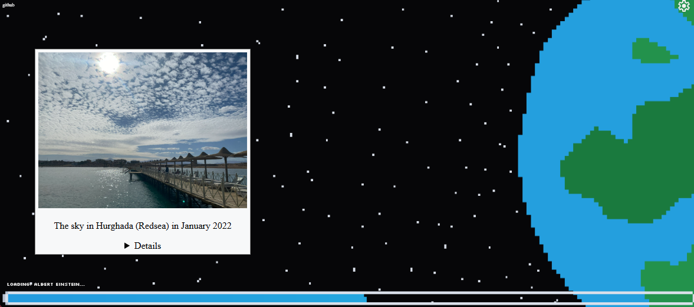

<h1>Earth loading screen: A joke loading screen for earth</h1>

heavily inspired by a tiktok trend. 

Try it here: <a href="https://earth-loading-screen.santtu.uk/">https://earth-loading-screen.santtu.uk/</a>

<h2>Test locally by running these in the folder:</h2>
 - npm install
 - npm run dev

<h2>How it works:</h2>

The site uses the wikimedia api to get a large amount of random cropped images and their associated information and then filters them by things like description length language, if its an actual image, if it's already been seen, if it has the word ISS or NOAA in the description and a similar one has already been shown, etc. 

There is also a loading bar in the bottom of the screen with a text saying loading and alternating between different things. 

<h2>Trying it:</h2>

By clicking on the details option in the slide you can see the author of the image, the license and the link to the image. 

If you want to configure for how long the slides are on screen you can do that in the settings by opening the settings menu with the associated icon and setting the words per minute to your liking. 

By default only one image with ISS or NOAA is shown because there tends to be a lot of those that are not very different. If you want to disable one or both of these you can also do that in the settings menu.

You can also disable the background image if you would prefer a white background.

